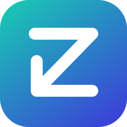
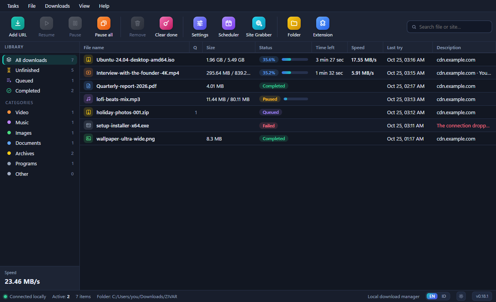
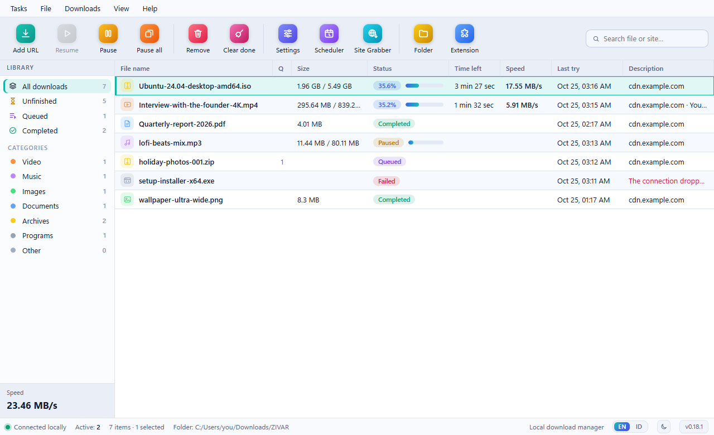

<p align="center">
  
</p>

<h1 align="center">ZIVAR Download Manager</h1>

<p align="center">
  Pengelola unduhan lokal dengan antrean, multi-koneksi, YouTube, HLS/DASH, dan ekstensi browser.<br>
  <i>A local download manager with queue, multi-connection downloads, YouTube, HLS/DASH and a browser companion extension.</i>
</p>

<p align="center">
  <a href="https://github.com/ravizulfikar/zivar-dm/actions/workflows/ci.yml"></a>
  <a href="https://github.com/ravizulfikar/zivar-dm/releases/latest"></a>
  <a href="LICENSE"></a>
</p>

<p align="center">
  <a href="README.md">English</a> · <b>Bahasa Indonesia</b>
</p>

<p align="center">
  <a href="https://github.com/ravizulfikar/zivar-dm/releases/latest">Unduh</a> ·
  <a href="docs/id/INSTALL.md">Panduan instal</a> ·
  <a href="CHANGELOG.md">Changelog</a> ·
  <a href="docs/id/DEVELOPMENT.md">Pengembangan</a> ·
  <a href="LICENSE">Lisensi MIT</a>
</p>

---

<p align="center">
  
  
</p>

## Fitur

**Mesin unduhan**
- Unduhan multi-koneksi dengan resume; jumlah koneksi per file dan unduhan bersamaan dapat diatur.
- Antrean yang bisa diurutkan ulang, jadwal antrean, pembatas kecepatan, dan proxy HTTP.
- Kategori otomatis (Video, Audio, Dokumen, Program, ...) dengan subfolder per kategori.
- Perbarui alamat unduhan yang kedaluwarsa, verifikasi checksum (SHA-256 dan lainnya), dan checksum yang diharapkan saat menambah unduhan.
- Tambah banyak URL sekaligus, termasuk pola seperti `foto[001-120].jpg`, plus **Site Grabber** untuk mengambil file dari sebuah halaman.
- Pantau clipboard, notifikasi desktop, dan aksi setelah semua unduhan selesai (keluar, tidur, matikan komputer).
- Jalan di system tray dan dapat dimulai otomatis saat login.
- Antarmuka bergaya aplikasi desktop (menu bar, toolbar, daftar kategori, dan tabel unduhan) dengan tema terang dan gelap, dalam bahasa **Inggris** (bawaan) atau **Indonesia** dengan satu klik.
- Pembaruan di dalam aplikasi: periksa, unduh, verifikasi checksum, dan pasang dari dialog Tentang; pembaruan juga bisa diunduh otomatis.

**Video**
- YouTube lewat yt-dlp: pilih resolusi, hanya audio (M4A/MP3), subtitle, dan seluruh playlist. Extractor dapat memperbarui dirinya setiap minggu.
- HLS (termasuk AES-128) dan DASH, termasuk lewat browser untuk CDN yang menolak klien biasa.
- Tombol unduh langsung di pemutar video situs.
- Video yang dilindungi DRM **tidak** didukung.

**Ekstensi browser (Chrome, Edge, Brave, dan browser Chromium lain; build Firefox tersedia)**
- Dialog info sebelum file dipindahkan ke ZIVAR: nama, ukuran, tipe, dan alamat sumber.
- Daftar tipe file dan daftar situs pengecualian yang dapat diatur dari aplikasi.
- Kredensial sementara (cookie, referer) hanya dikirim ke aplikasi lokal dan tidak disimpan permanen.

**Privasi dan keamanan**
- Semua berjalan lokal. Aplikasi hanya mendengarkan `127.0.0.1` dan memakai token pairing.
- Pembaruan aplikasi diunduh lewat antrean ZIVAR sendiri, diverifikasi SHA-256, dan tidak pernah dijalankan otomatis.
- Binary dibuat dengan Electron fuses (`runAsNode` mati, ASAR terverifikasi).

## Unduh dan instal

Ambil versi terbaru dari halaman [Releases](https://github.com/ravizulfikar/zivar-dm/releases/latest).

| Sistem | File | Catatan |
| --- | --- | --- |
| Windows 10/11 (x64) | `ZIVAR-Setup-<versi>.exe` | Installer. |
| | `ZIVAR-<versi>-Portable.exe` | Tanpa instalasi. |
| macOS (Apple Silicon) | `ZIVAR-<versi>-mac-arm64.dmg` | Lihat catatan Gatekeeper di bawah. |
| macOS (Intel) | `ZIVAR-<versi>-mac-x64.dmg` | |
| Ubuntu, Debian, Linux Mint, Pop!_OS | `ZIVAR-<versi>-linux-amd64.deb` / `-arm64.deb` | `sudo apt install ./file.deb` |
| Fedora, RHEL, openSUSE | `ZIVAR-<versi>-linux-x86_64.rpm` / `-aarch64.rpm` | `sudo dnf install ./file.rpm` |
| Distro Linux lain (Arch, dll.) | `ZIVAR-<versi>-linux-<arsitektur>.AppImage` | `chmod +x file.AppImage && ./file.AppImage` |
| | `ZIVAR-<versi>-linux-<arsitektur>.tar.gz` | Arsip biasa. |

Linux tersedia untuk x64 dan arm64. Bandingkan hasil unduhan dengan `SHA256SUMS.txt` di halaman rilis. Langkah lengkap, pemecahan masalah, dan cara memasang ekstensi ada di [docs/id/INSTALL.md](docs/id/INSTALL.md).

**macOS:** build belum ditandatangani Apple. Jika muncul peringatan "tidak dapat diverifikasi", klik kanan aplikasi → **Open**, atau jalankan `xattr -dr com.apple.quarantine "/Applications/ZIVAR Download Manager.app"`.

**Windows:** SmartScreen dapat memperingatkan karena installer belum ditandatangani. Pilih **More info → Run anyway** setelah mencocokkan checksum.

## Memasang ekstensi browser

Ekstensi disertakan dalam aplikasi dan disalin ke folder data saat ZIVAR pertama kali dibuka.

1. Buka `chrome://extensions` dan aktifkan **Developer mode**.
2. Klik **Load unpacked**, lalu pilih folder ekstensi ZIVAR (lokasinya ditampilkan di jendela **Panduan Chrome** di aplikasi).
3. Klik ikon ZIVAR Download Companion, tempel **kode pairing** dari aplikasi, lalu **Hubungkan**.

## Penggunaan singkat

- **Tambah URL** untuk satu atau banyak tautan; atau salin URL dan biarkan pemantau clipboard menambahkannya.
- Klik tautan file di browser: ZIVAR menampilkan dialog info lalu **Mulai download** memindahkannya ke antrean, atau **Lanjutkan di Chrome** jika Anda ingin browser mengunduhnya.
- Buka tab video, putar, lalu klik **Unduh video** di pojok pemutar untuk memilih kualitas.
- Pengaturan (koneksi, jadwal, proxy, tipe file yang ditangkap, mulai otomatis) ada di **Pengaturan unduhan**.

## Pembaruan

Buka **Tentang** (tombol versi di sisi kanan status bar, atau **Bantuan → Tentang**) lalu klik **Periksa pembaruan**. ZIVAR mengunduh file yang sesuai dengan cara pemasangannya (installer, portable, DMG, AppImage, `.deb`, atau `.rpm`), memeriksa checksum SHA-256-nya, lalu memasangnya saat Anda klik **Pasang dan mulai ulang**. Biarkan **Unduh pembaruan secara otomatis** aktif agar unduhan berjalan sendiri; pemasangan selalu atas klik Anda.

Pembaruan diambil dari berkas `latest.json` yang dilampirkan pada setiap rilis GitHub:

```
https://github.com/ravizulfikar/zivar-dm/releases/latest/download/latest.json
```

Ubah dengan `zivar.updateFeed` di `package.json` atau variabel lingkungan `ZIVAR_UPDATE_FEED`. Alamat installer wajib HTTPS dan memiliki checksum SHA-256.

## Pengembangan

Membutuhkan Node.js 24 atau lebih baru.

```bash
npm ci
npm start          # aplikasi desktop (Electron)
npm run start:web  # hanya server + UI di http://127.0.0.1:18765
npm test
```

Cara membangun installer, menjalankan smoke test, dan merilis ada di [docs/id/DEVELOPMENT.md](docs/id/DEVELOPMENT.md) dan [docs/id/RELEASING.md](docs/id/RELEASING.md).

## Struktur proyek

| Folder | Isi |
| --- | --- |
| `app/` | Mesin unduhan, server HTTP lokal, integrasi YouTube/FFmpeg, dan UI web |
| `desktop/` | Cangkang Electron: jendela, tray, notifikasi, autostart, aksi daya |
| `extension/` | Ekstensi browser Manifest V3 |
| `build/` | Konfigurasi packaging dan skrip rilis |
| `scripts/` | Smoke test dan skrip bantu |
| `tests/` | Unit test (`node --test`) |
| `docs/` | Dokumentasi (English; versi Indonesia di `docs/id/`) dan aset logo |

## Lisensi

Kode ZIVAR dirilis dengan [Lisensi MIT](LICENSE). Installer menyertakan Electron, yt-dlp, Node.js, dan FFmpeg yang memiliki lisensi masing-masing; lihat [THIRD_PARTY_NOTICES.md](THIRD_PARTY_NOTICES.md).

Gunakan ZIVAR hanya untuk konten yang Anda berhak mengunduhnya dan patuhi ketentuan layanan situs terkait.
